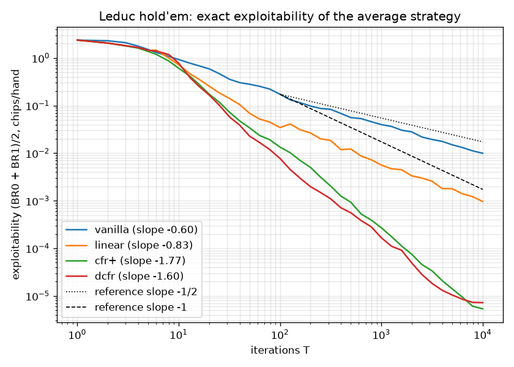
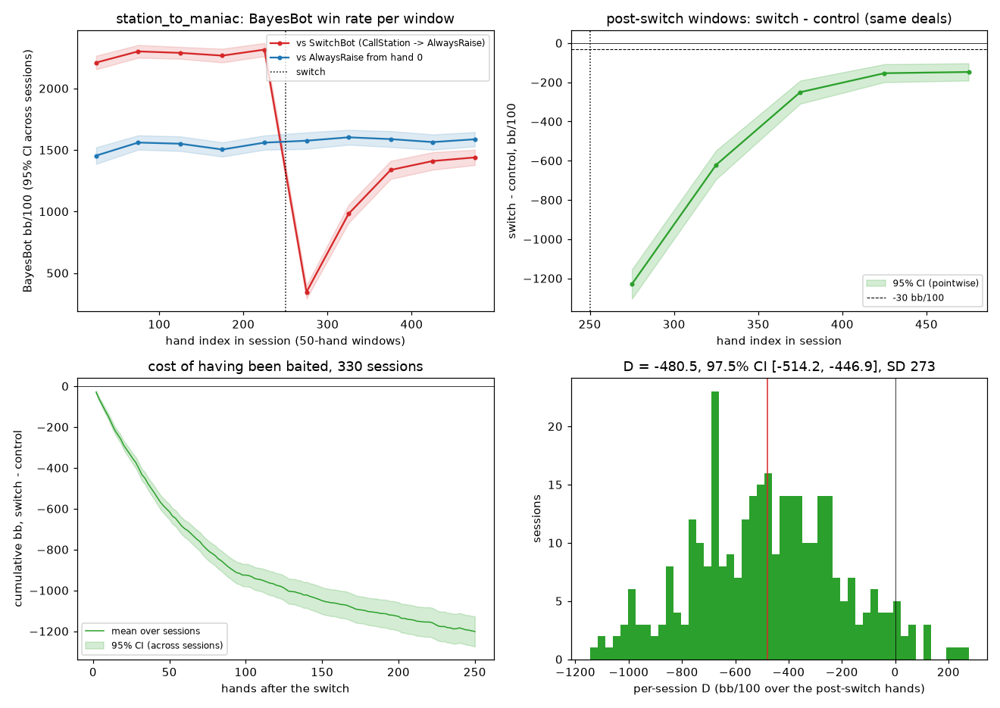
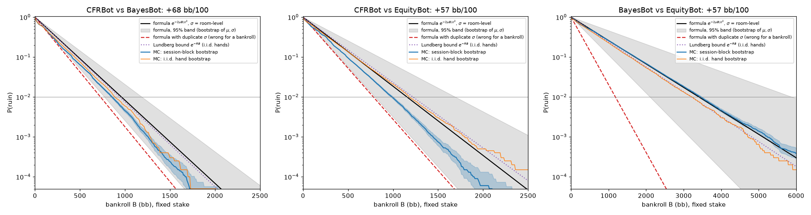

<!--
DRAFT. Before publishing:
- Rewrite in your own voice. Every sentence here is one you may be asked to defend in an interview.
- Decide how to handle the two reproducibility gaps listed under "Reproducing it" (blueprint not in the repo;
  some Phase 6/7 analyses ran on uncommitted code).
- Add your name / links at the bottom.
-->

# NutsFinder: measuring a small edge in a very noisy game

**TL;DR.** I built a heads-up No-Limit Hold'em engine and a ladder of five bot tiers from scratch in Python: rule-based,
Monte Carlo equity, Bayesian opponent modelling, and a game-theoretic bot trained with Monte Carlo CFR. The poker is
the setting. The real work was the evaluation. Every "bot X beats bot Y" claim was pre-registered, with seed, sample
size and decision rule committed before the run, and tested on a paired design. Each tier beat the one below it: the
Bayesian bot beat the equity bot by **+61.0 bb/100 (95% CI [+48.4, +73.5])**, and the CFR bot beat the Bayesian bot by
**+68.2 bb/100 ([+58.0, +78.3])**. Some results went against what I expected, and I report them too. The CFR bot is
still **highly exploitable**: a simple best-response probe wins more from it than it would lose by folding every hand.
The learning bot can be **baited into losing 480 bb/100** by an opponent that switches style. And **full Kelly sizing
goes broke 65% of the time** if you can only resize between sessions. About 3 million hands were played in official
runs.

---

## 1. Poker in 60 seconds (skip if you play)

- Two players each get two private cards. Five shared cards are dealt in stages (flop, turn, river), with a betting
  round before and after each stage. The best five-card hand at the end wins the pot, unless someone folds first.
- It is a game of **hidden information**: you never see the opponent's cards, so every decision is made against a
  *distribution* of possible hands.
- **bb/100** means big blinds won per 100 hands. It is the standard win-rate unit. Good human professionals win
  roughly 2–10 bb/100. The edges here are larger because the opponents are bots with fixed, simple leaks.
- **Equity**: the probability your hand wins if all remaining cards were dealt now. **Pot odds**: the share of the
  final pot you must pay to call. If equity > pot odds, calling has positive expected value (EV).

## 2. The actual problem: noise

Poker results are extremely noisy compared with the edges you care about. In this project the standard deviation of
one 500-hand session was **62–190 bb/100**, against edges between the upper tiers of **40–70 bb/100**. Sessions where the
better bot loses are common. If you look at a few thousand hands and declare a winner, you are mostly measuring
card luck.

So the core of the project is the measurement protocol. These are the parts of it:

**Duplicate matches (a paired design).** Every deal is played twice with the seats swapped, so both bots get the same
cards. Card luck largely cancels. Measured on the same hands, this cut the number of hands needed for a given
precision by **1.1x to 3.5x** across the tier 1–2 pairings. It helps most when the two bots play differently enough that
the mirrored hands diverge.

**Common random numbers across comparisons.** When comparing bot A and bot B against the same opponent, both play the
same deals with the same per-hand random seeds. The difference is then a paired estimate, and its variance is much
smaller than the sum of the two variances.

**The right unit of analysis.** From the Bayesian bot onward, bots *learn* during a match, so hands within a match are
not independent. The unit is an independent **session** of 500 hands with freshly created bots, and standard errors
are computed across sessions. That is the cluster-robust choice. Treating hands as i.i.d. would understate the error
for some pairings (for one of them the variance ratio was about 1.7).

**Pre-registration.** Before each official run I committed a file stating:

- the hypothesis and the one gating test;
- the decision rule ("beats" iff the 95% CI excludes 0 and the estimate is positive; a CI containing 0 is reported as
  "no detectable edge", never as "equal");
- the sample size, from a power calculation on a pilot run (pilot SD × 1.2 safety margin, 80% power);
- a fresh master seed, never used before.

From Phase 6 on, the official scripts refuse to run on an uncommitted tree, refuse to run twice, and append their output below a marker
in the pre-registration file. Results cannot be quietly rerun until they look good.

**Separate tuning and evaluation data.** The equity bot's parameters were tuned on one seed, checked on a hold-out
seed, and evaluated on a third. Choosing parameters on the data you report is overfitting.

**Sanity checks on the method itself.** A bot playing a copy of itself comes out at about 0. An empirical check of the CI
procedure gave **94.5%** coverage for a nominal 95%. Chip conservation was checked over 100,000
random hands. The hand evaluator was checked against all 133,784,560 seven-card hands.

## 3. The ladder

| tier | bot | how it decides | gating test (pre-registered) | result, bb/100 [95% CI] | hands |
|---|---|---|---|---|---:|
| 0 | Random / CallStation / AlwaysRaise | no thinking | – | – | – |
| 1 | PotOddsBot | call iff equity > call / (pot + call) | beats every baseline | beats all three; smallest margin +256.6 [+247.8, +265.4] | 20,000 each |
| 2 | EquityBot | Monte Carlo equity against an assumed opponent range, three bet sizes | beats PotOddsBot | **+266.8 [+237.8, +295.8]** | 20,000 |
| 3 | BayesBot | Beta-Binomial posteriors on the opponent's VPIP, aggression, fold-to-bet by size, and bluff rate; exploits what it learns | beats EquityBot | **+61.0 [+48.4, +73.5]** | 75,000 |
| 4 | CFRBot | approximate equilibrium strategy from Monte Carlo CFR on an abstracted game | beats BayesBot | **+68.2 [+58.0, +78.3]** | 80,000 |

Each row has its own fresh seed and commit, recorded in the results files linked at the end. The tier 3 result was
replicated on an independent seed in a later run (+57.4 [+36.1, +78.6]).

Two things a quant reader should note:

1. **The ladder is not transitive, and it was never claimed to be.** "A beats B and B beats C" says nothing about A
   vs C. Each claim is about one specific pair.
2. **Every opponent is one of my own bots.** None of these numbers says anything about play against humans.

## 4. Equilibrium vs exploitation

### Getting CFR right on small games first

Counterfactual Regret Minimisation (CFR) finds an approximate Nash equilibrium by self-play. At each decision it tracks
how much better each alternative would have done, and shifts towards the actions it "regrets" not taking. The average
strategy converges to equilibrium. I built it up in stages, each checked against a known answer:

- **Kuhn poker** (3 cards): reproduces the game value −1/18. Bluffing emerges without being programmed.
- **Leduc hold'em** (288 information sets): solved with four CFR variants. Exploitability is computed exactly with a
  best response. The game value is certified at −0.08561 chips/hand to within 5×10⁻⁶. After 10,000 iterations, CFR+ and DCFR
  are over 1,000x less exploitable than vanilla CFR.



- **Sampling (external-sampling MCCFR)** was validated on Leduc before being used on hold'em. It converges at roughly
  the 1/√T rate you would expect from Monte Carlo.

### Hold'em

Full no-limit hold'em is far too large to solve, so the bot solves a smaller **abstracted** game:

- the 169 strategically distinct starting hands preflop;
- 50 hand-strength buckets per later street;
- five actions: fold, call, a 3bb open, pot-sized bet, all-in.

That gives 57,304 information sets. The blueprint was trained for 13.2 million MCCFR iterations. Bets the abstraction
does not contain are mapped to the nearest abstract sizes ("action translation").

### How exploitable is it? (The honest part.)

"Beats the previous tier" is not the same as "close to equilibrium". To measure exploitability I used **Local Best
Response** (LBR; Lisý & Bowling, 2017). LBR is an exploiter that tracks the target's range with Bayes' rule and picks
the best one-step action. Its win rate is a **lower bound** on how exploitable the target is.

| target | LBR win rate, mbb/hand [95% CI] (primary rule) |
|---|---:|
| CFRBot | +1,097 [+806, +1,387] |
| BayesBot | +3,082 [+2,751, +3,414] |
| EquityBot | +2,836 [+2,530, +3,142] |

CFRBot is clearly the hardest of the three to exploit. In absolute terms, though, it is **bad**. A bot that folds
every hand loses 750 mbb/hand, so LBR takes more from CFRBot than CFRBot would lose by never playing. The likely
causes are the very coarse abstraction and action translation. The visible symptom is that it folds 62–68% of the
time when facing a bet after the flop, well above the ~50% minimum-defence frequency against a pot-sized bet.

**Disclosure.** I piloted three variants of LBR's preflop rule. I chose the primary one *after* seeing the pilot, and
it turned out to be the variant most favourable to CFRBot. Under the standard rule from the paper, CFRBot is still
clearly less exploitable than EquityBot. It is **not** detectably less exploitable than BayesBot (difference +479
mbb/hand, CI [−129, +1,088]). So "less exploitable than BayesBot" holds only under the rule I chose, and I report it
that way.

### The trade-off, in one table

CFRBot beats BayesBot head-to-head. Against weak opponents the picture reverses, and BayesBot wins far more. Paired
difference (CFRBot's win rate minus BayesBot's, same opponent, same deals):

| opponent | CFRBot − BayesBot, bb/100 [95% CI] |
|---|---:|
| EquityBot | −0.4 [−28.3, +27.6] |
| PotOddsBot | −332 [−364, −301] |
| RandomBot | −586 [−619, −553] |
| AlwaysRaiseBot | −1,365 [−1,391, −1,339] |
| CallStationBot | −2,001 [−2,031, −1,971] |

An equilibrium strategy guarantees that it cannot lose much. It does not try to punish mistakes. An exploitative
strategy earns far more from weak opponents, and that raises the obvious question.

## 5. Can the exploiter be exploited back?

BayesBot learns a model of its opponent and assumes the opponent's behaviour stays the same. Its model has no
forgetting: every past hand counts equally. That is a **regime-change** vulnerability.

To test it I built `SwitchBot`, which plays one style for 125 hands and then switches to another. The experiment
compared two versions of the same session:

- **switch arm:** BayesBot plays SwitchBot (style A, then style B);
- **control arm:** BayesBot plays style B from the first hand, on the same deals.

The estimand is the difference in BayesBot's win rate over the post-switch hands: the cost of having learned the
wrong thing. There were two pre-registered scenarios with a Bonferroni correction (α = 0.025 each):

| scenario | cost to BayesBot, bb/100 [97.5% CI] | sessions | recovers within the session? |
|---|---:|---:|---|
| passive caller → raises every hand | **−480.5 [−514.2, −446.9]** | 330 | no |
| raise-or-fold → passive caller | **−47.3 [−82.9, −11.6]** | 170 | yes, after ~200 hands |



In the first scenario BayesBot spends 125 hands learning that its opponent never bets. It then reads every raise as a
very strong hand and folds. In the first 50 hands after the switch it does 1,229 bb/100 worse than the control.

CFRBot, which does not learn, is unaffected **by construction**. Its post-switch hands were identical in both arms in
every one of the 500 sessions, which doubled as an integrity check on the seeding. Even after being baited, BayesBot
still earns far more than CFRBot against these weak opponents. Adaptivity is worth the risk here, but the risk is real
and measurable.

## 6. Six players

Multi-player poker has no clean equilibrium theory, and a win rate belongs to the (bot, table) pair, not to the bot.
I built a separate N-player engine (2–8 seats, side pots). It was checked against an independent reference
implementation on 126,000 hands, and against the heads-up engine hand-for-hand at two players.

The duplicate idea extends to six seats: each deal is played six times, so every bot sits in every seat once.
Pre-registered test: does the Bayesian bot beat the equity bot when sitting in the same seat against the same mixed
field (two competent bots, a passive caller, a maniac, a random player)?

**Result: +42.7 bb/100 [+12.7, +72.6]**, 110 sessions, 165,000 hands per arm. It holds for this field only.

**Disclosure.** This test broke my own pre-registration rule. The planned sample size did not fit the time budget, so
after the pilot I raised the target effect size from 50 to 60 bb/100, which lowered the required N. My pre-pilot rule
said never to change the target. The pilot estimate was visible at the time (−8.0, CI [−96.5, +80.5]). A larger target
only *reduces* the power to find "beats", so the change does not favour the result I expected, but it is still a
deviation. The observed effect needs about 111 sessions for 80% power, and I ran 110, so this result is on the edge
of what the design can detect.

## 7. Sizing: Kelly, risk of ruin, and which variance

Suppose you had to bankroll CFRBot against BayesBot. The project treats this as a sizing problem with an *estimated*
edge (μ = 0.68 bb/hand, t-statistic 13).

| question | answer [95% CI] |
|---|---|
| bankroll for 1% risk of ruin at a fixed stake | **860 bb [680, 1,060]** (block-bootstrap simulation); diffusion formula σ²ln(1/r)/2μ gives 961 [774, 1,189] |
| Kelly bankroll, resizing every hand | **420 bb [370, 491]** |
| P(ever halving the bankroll), full Kelly / half Kelly | 44% / 9% (simulation; formula 50% / 12%) |
| full Kelly, stakes changed only between 250-hand sessions | **65% ruin within 50,000 hands**, still rising with the horizon |

The findings that were not obvious to me in advance:

- **Discrete resizing breaks Kelly.** The textbook result that Kelly never goes broke assumes you resize continuously.
  If you can only change stakes between sessions, one bad session can wipe you out: the worst in-session drawdown
  observed was 631 bb, more than the 417 bb Kelly unit. You have to size for the worst session, not for σ²/μ.
- **Use the right variance for the question.** Duplicate (paired) variance is the right one for *measuring* an edge
  and the wrong one for *sizing* a bet, because a real player never gets the mirrored hand. Plugging it into the ruin
  formula understates the required bankroll by 25% for this pairing and by up to 4.6x for others.
- **Skew decides whether the formula is safe.** These results are right-skewed (big wins at showdown, many small
  losses from folds), so the diffusion formula is *conservative* by about 10%. With left-skewed results it would be
  optimistic, which is the dangerous direction. You only know which case you are in by checking.
- **Estimation error matters most when t is small.** On the first 10,000 hands alone, the same matchup measured
  44.5 bb/100 (t = 3.2), and a robust sizing rule drops to about 0.4–0.5 Kelly. With a flat prior, a Bayesian does not
  shrink the stake at all, because expected log-growth is linear in μ. Shrinkage has to come from an informative
  prior, from risk aversion, or from model uncertainty.



## 8. Variance reduction: half the hands for the same answer

On top of duplicate matches I added a **control variate** for board-card luck, a chance-node-only version of AIVAT.
At every flop, turn and river card, it subtracts pot × (change in exact equity, given both players' cards). Equity is
a martingale over the deal, so every correction term has mean zero, *whatever the bots do*. The estimator is
therefore unbiased for any strategy.

| pairing | variance removed per session [95% CI] |
|---|---:|
| CFRBot vs BayesBot | **48% [21%, 66%]** |
| CFRBot vs AlwaysRaiseBot | 39% [28%, 49%] |
| BayesBot vs EquityBot | 24% [−8%, 47%] (not detectable) |

Two lessons:

- **Unbiasedness depends on a subtle condition.** The obvious version, which adjusts only hands that reach showdown, is
  **biased**, because whether a hand reaches showdown depends on the cards dealt. A test enumerates all 1,980 turn-river
  deals of a hand with card-dependent betting. The correct estimator matches the raw mean exactly. The "peeking"
  version is off by 4.5 chips per hand.
- **Per-hand gains do not automatically carry over to the unit you analyse.** Per hand, the control variate removed
  45% of the variance in *every* pairing. At the session level, the gain vanished whenever BayesBot was involved.
  A plausible mechanism (not proven): early luck shapes what BayesBot learns, and so affects its later results, and a
  per-hand correction cannot remove that.

## 9. Where I deviated from the plan

These are all disclosed in the results files. They are collected here because a reader should not have to dig for
them.

1. **LBR preflop rule chosen after the pilot** (section 4). Both rules are reported, and the claim that depends on the
   choice is labelled as such.
2. **6-max target effect size changed after the pilot**, against my own rule (section 6).
3. **Exploit-back test:** the target effect size was raised from 30 to 60 bb/100 after the pilot. One scenario was
   replaced after a 2-session smoke run showed that it could not test the mechanism.
4. **Variance-reduction runs:** two pairings shared a seed, so an early claim that they were independent was wrong. It
   was corrected with a covariance-aware combined test, and the conclusion did not change.
5. **Multiple testing:** only the one gating test per experiment supports a claim. The dozens of secondary CIs are
   uncorrected and descriptive, and about 1 in 20 will exclude its true value by chance.

## 10. Limitations

- **Every opponent is my own bot.** Nothing here measures performance against humans or strong public bots.
- **CFRBot is far from equilibrium.** The abstraction is tiny (five actions, 50 buckets per street), and the bot
  overfolds badly.
- **Fixed format.** Stacks reset to 100 big blinds every hand, there is no rake in the main results, and play is
  limited to heads-up and one 6-max field.
- **Normal-approximation CIs** across 50–330 sessions. That is reasonable at these sample sizes, but it is an
  approximation.
- **The bankroll simulation cannot produce a session worse than any observed one**, so very rare tail risks are
  invisible to it. That is why half-Kelly ruin with discrete stakes is reported as "not estimable", not as zero.

## 11. What I would do next

- A finer abstraction (a half-pot bet, more buckets), then re-run the same pre-registered LBR test to see whether the
  overfolding goes away.
- Full AIVAT, which also uses the bots' strategies at action nodes, for larger variance reduction.
- Give BayesBot forgetting or change-point detection, and re-run the regime-change test against it.
- Evaluate against an external benchmark bot, so at least one number is not "my bot vs my bot".

## 12. Reproducing it

Python 3.12, NumPy, pytest. There are nearly 800 test functions, and CI runs them on every push.

```bash
python3.12 -m venv .venv && source .venv/bin/activate
pip install -e ".[dev]"
pytest
python examples/kuhn_cfr.py      # CFR learns to bluff in a few seconds
```

Each official experiment has a script in `examples/` and a results file in `results/`. The results file contains the
pre-registration, the pilot, every disclosure, and the full output:

| experiment | results file |
|---|---|
| baselines and the duplicate-match method | [`results/baselines.md`](../results/baselines.md) |
| tiers 1–2 | [`results/phase4.md`](../results/phase4.md) |
| tier 3 | [`results/phase5.md`](../results/phase5.md) |
| tier 4 and LBR | [`results/phase6.md`](../results/phase6.md), [`results/phase6_lbr_2026-11-17.md`](../results/phase6_lbr_2026-11-17.md) |
| CFR on Leduc, MCCFR | [`results/phase6_leduc.md`](../results/phase6_leduc.md), [`results/phase6_mccfr.md`](../results/phase6_mccfr.md) |
| exploit-back | [`results/phase7_exploit_back.md`](../results/phase7_exploit_back.md) |
| 6-max | [`results/phase7_6max.md`](../results/phase7_6max.md) |
| bankroll, Kelly, variance reduction | [`results/phase7_bankroll.md`](../results/phase7_bankroll.md), derivations in [`docs/phase7_bankroll_notes.md`](phase7_bankroll_notes.md) |

The CFRBot blueprint is identified by its SHA-256
(`4539e9c7adbc62ace90b989ea257c1ce220639f18fd8a179f8d03b712ac024f3`) and its training seed and commit, so a
retrained file can be checked against it.
