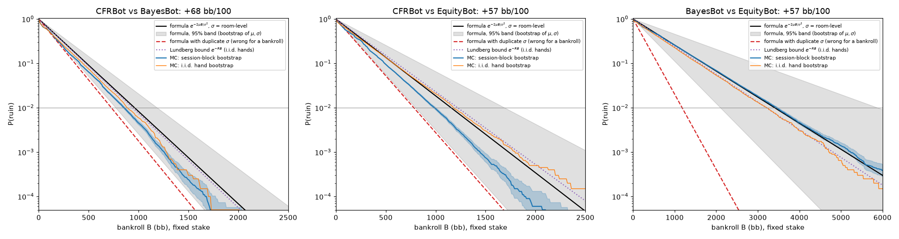
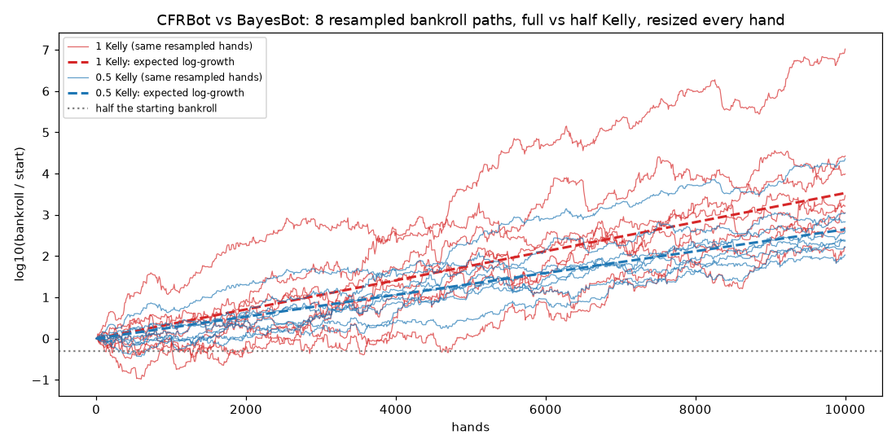
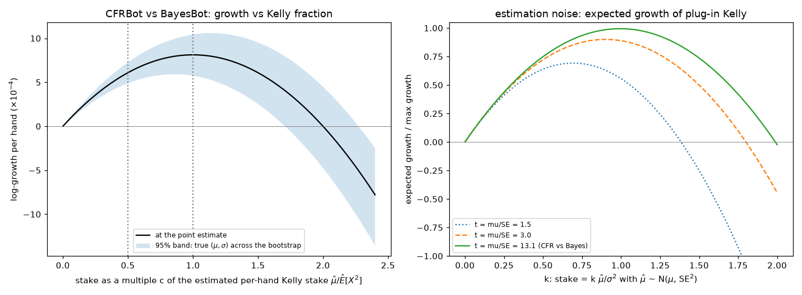
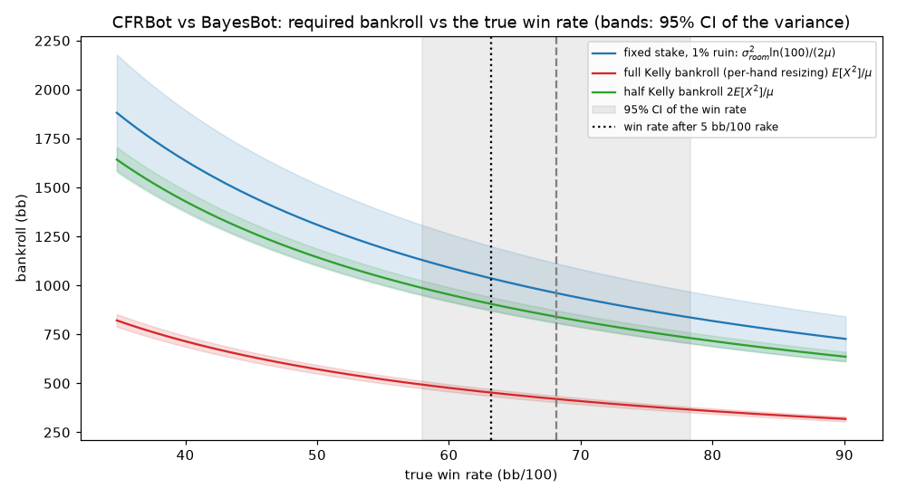

# Phase 7: variance reduction, Kelly sizing and bankroll simulation

Date 2026-11-17/18, built on commit c3a383e plus uncommitted Phase 7 code. The derivations of every formula are in
[`docs/phase7_bankroll_notes.md`](../docs/phase7_bankroll_notes.md).

**Headline numbers** (CFRBot vs BayesBot, 160 official sessions, 80,000 hands, 95% CIs):

- **Bankroll for 1% risk of ruin at a fixed stake:** 961 bb [774, 1,189] from the diffusion formula, and
  **860 bb [680, 1,060]** from a block-bootstrap simulation of the real results (nested bootstrap for the
  data uncertainty). The formula is conservative by about 10% here, but that gap is well inside the data uncertainty.
- **Kelly bankroll with per-hand resizing, E[X²]/μ:** **420 bb [370, 491]**, so half Kelly is about 840 bb. Full Kelly
  halves the bankroll at some point with probability 44% (simulation; the formula says 50%). Half Kelly does so with
  probability 9.3% (formula 12.3%).
- **Stakes resized only between 250-hand sessions** (session-level Kelly σ_room²/μ = 417 bb): discrete stake levels at
  full Kelly go bust in **65%** of 50,000-hand paths. The reason is that a single session can lose more than 417 bb, and
  this ruin probability keeps growing with the horizon. At half Kelly, ruin is **not estimable** by this bootstrap
  (section 5).
- **Duplicate SD in the ruin formula:** it understates the 1% bankroll by 25% here (728 instead of 961 bb), and by up
  to 4.6x for other matchups.
- **Variance reduction:** an unbiased chance-node control variate (exact board-card luck removal) cuts the SD of
  CFRBot vs BayesBot session results by a factor of **0.72 [0.58, 0.89]**, i.e. **48% fewer hands [21%, 66%]** for the
  same precision. All-in luck adjustment alone: 0.82 [0.66, 1.02]. For BayesBot vs EquityBot the reduction is
  large per hand but **not detectable per session** (0.87 [0.73, 1.04]).

---

## 1. What was done

| piece | files |
|---|---|
| Formulas (diffusion ruin, Kelly, fractional Kelly, P(ever halving), parameter uncertainty, exact Kelly, Lundberg exponent) | `src/nutsfinder/bankroll/kelly.py` |
| μ and σ per matchup from session data (three variances, cluster bootstrap over sessions) | `src/nutsfinder/bankroll/estimate.py` |
| Monte Carlo bankroll paths (block bootstrap; fixed stake, continuous Kelly, discrete stake levels) | `src/nutsfinder/bankroll/simulate.py` |
| Exact heads-up equity (all 1.7M preflop boards in ~0.07 s) | `src/nutsfinder/eval/hu_equity.py` |
| All-in adjustment and chance control variate | `src/nutsfinder/eval/variance_reduction.py` |
| Part A run (official data, no poker played) | `examples/run_phase7_bankroll.py` -> `results/2026-11-18_phase7_bankroll.json` + 4 PNGs |
| Part B run (new matches with hand logs) | `examples/run_phase7_variance.py` -> `results/2026-11-17_phase7_variance_{CFR_vs_Bayes,Bayes_vs_Equity}.json/.png`, `results/2026-11-18_phase7_variance_powercheck_CFR_vs_AlwaysRaise.json/.png`, `results/2026-11-18_phase7_variance_combined_unbiasedness.json` (post-hoc) |
| Tests (36) | `tests/test_bankroll.py`, `tests/test_variance_reduction.py` |

Seeds, all new and never used before in this repository:

| seed | used for |
|---|---|
| 27,182,818 | bootstrap; per matchup k, formula bands use `[27182818, k]` and the nested bootstrap uses its own stream `[27182818, k, 1]`; the post-hoc ratios use `[27182818, 1, j]` per pairing j |
| 16,180,339 | Monte Carlo; each experiment has its own stream `default_rng([16180339, k])` |
| 31,415,926 | Part B match master seed, **shared by both main pairings** (section 8) |
| 17,320,508 | Part B power check |
| 14,142,135 | smoke runs, nothing saved |

The official result files and `models/` were only read.

## 2. Formulas in one screen

| quantity | formula | CFR vs Bayes |
|---|---|---|
| fixed-stake risk of ruin | exp(-2 μ B / σ²) | |
| bankroll for ruin r (σ = σ_room) | σ² ln(1/r) / (2μ) | 961 bb at r = 1% |
| Kelly bankroll, per-hand resizing | E[X²]/μ bb (stake fraction μ/E[X²], per-hand second moment) | 420 bb |
| Kelly bankroll, resizing only between sessions (Gaussian sessions) | σ_room²/μ | 417 bb |
| full-Kelly log-growth | μ²/(2E[X²]) per hand | 8.1e-4, doubling every 854 hands |
| growth at c x Kelly | (2c - c²) of the maximum | 0 at c = 2 |
| P(ever falling to x of the bankroll), continuous resizing | x^((2/c - 1)·E[X²]/σ_room²); x^(2/c - 1) for i.i.d. hands | scale 1.01: halving 0.50 at c = 1, 0.123 at c = 1/2 |
| plug-in Kelly with noisy μ̂ (t = μ/SE) | expected growth 1 - 1/t² of the maximum; best shrink t²/(1+t²) | t = 13.1 -> 0.994 |
| misspecified edge (true μ = λ μ̂) | growth (2cλ - c²)/λ² of the true maximum | full Kelly on a 2x overestimate -> 0 |

The P(ever falling to x) formula from the brief, 2^-(2/c-1) for halving, is **correct**. It is derived in notes
section 4: log-wealth is a Brownian motion with 2·drift/variance = 2/c - 1. It is also checked by simulation in
`tests/test_bankroll.py` and below.

**Correction after review:** that holds for i.i.d. hands. With dependent hands, the two parts of the formula come
from different variances:

- the drift of log W is a per-hand expectation, so Kelly uses E[X²];
- the fluctuation of log W uses the long-run σ_room².

So the exponent is multiplied by E[X²]/σ_room², which is checked by a test with dependent hands. The scale is 0.94-1.17
for ten pairings and **0.63 for BayesBot vs RandomBot**. For that pairing, full Kelly halves the bankroll with
probability 65%, not 50%.

Under continuous resizing, ruin is impossible: every loss shrinks the next stake. At a fixed stake, the Kelly bankroll
σ²/μ (i.i.d. hands) has ruin probability e^-2 = 13.5%. Kelly avoids ruin only by moving down.

## 3. Which σ? Three variances per matchup

Hands are not i.i.d. in the official data. Each 500-hand session is a duplicate match: 250 deals, each played in two
"rooms" with the seats swapped, by fresh bots. From it:

- **σ_hand**: SD of single hands, pooled.
- **σ_room**: the long-run per-hand SD that one player in one seat experiences, sqrt(Var(250-hand room total)/250).
  It includes within-session dependence. **This is the σ for fixed-stake ruin**, for stakes changed only between
  sessions, and for the fluctuation of log-wealth. The Kelly fraction under per-hand resizing uses the per-hand second
  moment E[X²] = σ_hand² + μ² instead (notes sections 3, 4 and 6).
- **σ_dup**: from the 500-hand duplicate totals. Duplicate cancels card luck with the mirror hand, which a real player
  never gets. It is the right σ for measuring an edge and the wrong σ for a bankroll.

All CIs are percentile bootstraps over sessions (4,000 resamples, both rooms of a session kept together). bb/100 CIs
here are bootstrap CIs, so they differ slightly from the normal-approximation CIs in phase6.md.

| matchup | sessions (hands) | bb/100 [95% CI] | σ_hand | σ_room [CI] | var room/hand [CI] | var dup/hand | **Kelly bankroll E[X²]/μ, per-hand resizing [CI]** | **1% ruin bankroll σ_room² ln100/(2μ) [CI]** | 1% bankroll with σ_dup (wrong) |
|---|---|---|---|---|---|---|---|---|---|
| CFRBot vs BayesBot | 160 (80,000) | +68.2 [+57.7, +78.3] | 16.9 | 16.9 [15.5, 18.2] | 1.00 [0.85, 1.15] | 0.75 | 420 [370, 491] | 961 [774, 1189] | 728 |
| CFRBot vs EquityBot | 50 (25,000) | +57.0 [+39.4, +74.4] | 17.6 | 16.9 [14.4, 19.3] | 0.93 [0.69, 1.19] | 0.63 | 542 [419, 772] | 1154 [797, 1702] | 781 |
| CFRBot vs PotOddsBot | 50 (25,000) | +60.3 [+41.8, +78.4] | 20.2 | 20.8 [17.9, 23.7] | 1.07 [0.80, 1.34] | 0.54 | 677 [529, 965] | 1658 [1114, 2534] | 847 |
| CFRBot vs CallStationBot | 120 (60,000) | +223.4 [+211.0, +236.0] | 20.0 | 18.6 [17.1, 20.0] | 0.87 [0.74, 1.00] | 0.64 | 180 [171, 191] | 356 [301, 414] | 261 |
| CFRBot vs AlwaysRaiseBot | 200 (100,000) | +175.6 [+154.6, +195.3] | 35.1 | 34.5 [31.8, 37.1] | 0.97 [0.82, 1.12] | 0.88 | 704 [637, 792] | 1562 [1303, 1879] | 1422 |
| CFRBot vs RandomBot | 130 (65,000) | +217.5 [+206.2, +228.8] | 16.2 | 15.4 [14.1, 16.6] | 0.91 [0.76, 1.05] | 0.85 | 123 [119, 128] | 253 [211, 295] | 235 |
| BayesBot vs EquityBot | 50 (25,000) | +57.4 [+36.4, +79.3] | 28.3 | 29.1 [25.2, 32.7] | 1.06 [0.80, 1.33] | 0.37 | 1398 [1017, 2197] | 3407 [2142, 5966] | 1180 |
| BayesBot vs PotOddsBot | 50 (25,000) | +392.5 [+367.6, +416.6] | 34.2 | 33.7 [27.9, 39.3] | 0.97 [0.66, 1.34] | 0.33 | 302 [282, 323] | 665 [447, 926] | 229 |
| BayesBot vs CallStationBot | 120 (60,000) | +2224.1 [+2197.4, +2253.1] | 71.7 | 75.0 [66.0, 83.8] | 1.09 [0.85, 1.36] | 0.24 | 254 [250, 257] | 583 [453, 725] | 126 |
| BayesBot vs AlwaysRaiseBot | 200 (100,000) | +1540.2 [+1515.9, +1564.3] | 70.0 | 71.9 [65.9, 77.6] | 1.05 [0.89, 1.23] | 0.31 | 334 [329, 339] | 772 [650, 899] | 226 |
| BayesBot vs RandomBot | 130 (65,000) | +803.4 [+772.7, +837.9] | 36.8 | 47.5 [43.5, 51.6] | **1.67 [1.40, 1.96]** | 1.34 | 176 [170, 182] | 646 [543, 762] | 518 |
| BayesBot vs EquityBot (Phase 5, seed 20261117) | 150 (75,000) | +61.0 [+48.5, +73.6] | 28.5 | 29.0 [25.9, 32.1] | 1.03 [0.83, 1.26] | 0.38 | 1337 [1116, 1671] | 3172 [2368, 4278] | 1161 |

What the table says:

- **Within-session dependence is small for 10 of 11 pairings.** var_room/var_hand is near 1, and every CI contains 1
  except CFR vs CallStation (0.87 [0.74, 1.00], borderline). The exception is BayesBot vs RandomBot at 1.67 [1.40, 1.96]:
  how fast BayesBot's model locks on varies from session to session, so whole sessions run hot or cold together. For
  that pairing, i.i.d. per-hand maths would understate the fixed-stake bankroll by 40%.
- **Duplicate variance is 24-88% of the per-hand variance in ten pairings, and 134% for BayesBot vs RandomBot.** In that
  pairing, whole sessions run hot or cold together. Relative to σ_room² the duplicate variance is 22-93% in every
  pairing, so plugging it in always understates the bankroll, by up to 4.6x (BayesBot vs CallStationBot: 126 instead
  of 583 bb).
- **These edges are enormous compared with human poker** (good players win 2-10 bb/100), so the bankrolls are small.
  BayesBot vs EquityBot (+57 bb/100 at σ = 29) needs 3.5 times the bankroll of CFR vs Bayes (+68 at σ = 17),
  because the bankroll scales with σ²/μ.
- The Phase 5 replication of BayesBot vs EquityBot (another seed, 150 sessions) agrees with Phase 6 within the CIs, and
  is three times tighter.

**Exact (non-diffusion) Kelly and the effect of resizing frequency** (point estimates):

| matchup | E[X²]/μ (per hand) | exact per-hand Kelly, argmax mean log(1 + f X) | σ_room²/μ (Gaussian sessions) [CI] | exact Kelly, resizing only between 250-hand sessions | worst room session (bb) | drawdown scale E[X²]/σ_room² |
|---|---|---|---|---|---|---|
| CFRBot vs BayesBot | 420 | 414 | 417 [336, 516] | 553 | -524 | 1.01 |
| CFRBot vs EquityBot | 542 | 532 | 501 [346, 739] | 540 | -464 | 1.08 |
| CFRBot vs PotOddsBot | 677 | 662 | 720 [484, 1100] | 809 | -662 | 0.94 |
| CFRBot vs CallStationBot | 180 | 190 | 155 [131, 180] | 154 | -153 | 1.17 |
| CFRBot vs AlwaysRaiseBot | 704 | 661 | 679 [566, 816] | 1191 | -1172 | 1.04 |
| CFRBot vs RandomBot | 123 | 131 | 110 [92, 128] | 116 | -116 | 1.12 |
| BayesBot vs EquityBot | 1398 | 1394 | 1480 [930, 2591] | 1654 | -1048 | 0.94 |
| BayesBot vs PotOddsBot | 302 | 296 | 289 [194, 402] | 463 | -456 | 1.04 |
| BayesBot vs CallStationBot | 254 | 253 | 253 [197, 315] | n/a: no losing session | +2424 | 1.00 |
| BayesBot vs AlwaysRaiseBot | 334 | 326 | 335 [282, 391] | n/a: no losing session | +850 | 1.00 |
| BayesBot vs RandomBot | 176 | 187 | **281** [236, 331] | n/a: no losing session | +138 | **0.63** |
| BayesBot vs EquityBot (Phase 5) | 1337 | 1332 | 1378 [1028, 1858] | 1715 | -1471 | 0.97 |

**Comparing the per-hand Kelly bankrolls:**

- E[X²]/μ and the exact per-hand Kelly agree to within 6% in every pairing (CFR vs AlwaysRaise 704 vs 661, CFR vs
  RandomBot 123 vs 131). Single hands are small compared with the bankroll.
- σ_room²/μ (the pre-review column) is **not** a per-hand Kelly bankroll. It differs from the exact value by up to 50%:
  BayesBot vs RandomBot 281 vs 187, CFR vs CallStation 155 vs 190, CFR vs Random 110 vs 131.

If you can only change stakes between sessions, the "bet" is a whole session, which can lose 500-1,200 bb. The exact
Kelly bankroll then rises by up to 1.8x. This is the first sign of the result in section 5.

## 4. Risk of ruin: formula vs simulation

**Simulation design:**

- Resample whole 250-hand room sessions of real results (block bootstrap: keeps the fat tails and the
  within-session dependence).
- 100,000 paths of 50,000 hands each; ruin is checked after every hand.
- Comparison simulation: an i.i.d. single-hand bootstrap, 20,000 paths.
- Formula band: exp(-2μB/σ²) evaluated over 4,000 bootstrap draws of (μ, σ_room).
- Lundberg bound: e^{-RB}, with R solved on the real hand distribution.

Simulated probabilities carry 95% Wilson CIs, which cover simulation error only. Horizon check: on the **same**
100,000 paths, the running minimum recorded after 25,000 hands (a checkpoint inside the 50,000-hand run) gives
the same ruin curve. The largest difference over the whole bankroll grid is 0 for three runs and 9e-5 for Bayes vs
Equity. So "within 50k hands" stands in for "ever". (The pre-review check drew new paths for the half horizon and
did not show this.)

| CFRBot vs BayesBot, B (bb) | 50 | 200 | 400 | 600 | 800 | 1,000 | 1,500 |
|---|---|---|---|---|---|---|---|
| formula exp(-2μB/σ²) | 0.787 | 0.383 | 0.147 | 0.056 | 0.022 | 0.0083 | 0.0008 |
| formula, 95% band (data) | [0.74, 0.82] | [0.30, 0.46] | [0.09, 0.21] | [0.028, 0.097] | [0.008, 0.045] | [0.0026, 0.021] | [0.0001, 0.003] |
| **simulation (session blocks)** | 0.648 [0.646, 0.651] | 0.306 [0.303, 0.309] | 0.110 [0.108, 0.112] | 0.040 [0.039, 0.041] | 0.013 [0.013, 0.014] | 0.0045 [0.0041, 0.0050] | 0.0002 [0.0002, 0.0004] |
| simulation (i.i.d. hands) | 0.653 | 0.326 | 0.123 | 0.045 | 0.017 | 0.0060 | 0.0003 |
| Lundberg bound e^{-RB} | 0.783 | 0.376 | 0.141 | 0.053 | 0.020 | 0.0075 | 0.0007 |
| formula with σ_dup (wrong) | 0.729 | 0.282 | 0.080 | 0.022 | 0.006 | 0.0018 | 0.0001 |

| bankroll for 1% ruin (bb) | diffusion formula [bootstrap CI] | simulation: point (simulation-error-only CI) | simulation: nested bootstrap, 200 x 20,000 paths [95% CI] |
|---|---|---|---|
| CFRBot vs BayesBot | 961 [774, 1189] | 860 (870) | 860 [680, 1060] |
| CFRBot vs EquityBot | 1154 [797, 1702] | 990 (1010) | 995 [660, 1590] |
| BayesBot vs EquityBot | 3407 [2142, 5966] | 3460 (3500) | 3490 [2050, 5740] |

The nested bootstrap's outer resamples now come from their own stream (`[27182818, k, 1]`). Before the review they
reused the formula band's stream, so the formula band and the nested CI were built on the same resampled datasets
and were not independent. Changing the stream moved the nested CIs by Monte Carlo noise only: CFR vs Bayes
[660, 1050] -> [680, 1060], CFR vs Equity [640, 1380] -> [660, 1590], Bayes vs Equity [2020, 6310] -> [2050, 5740].
With 200 outer replicates the CI ends themselves are uncertain by roughly ±10%.
| CFRBot vs BayesBot, 5 bb/100 rake | 1037 [830, 1302] | 940 (950) | (not run) |

**Where the diffusion fails:**

1. **Small bankrolls (B up to ~2 hands' worth of swings).** At B = 50 bb the formula says 79%, the simulation 65%.
   The diffusion has no jumps and treats any small dip as ruin. Real results are lumpy, many hands move only a blind
   or two, and a single hand is bounded by the 100 bb stack. At small B, discreteness dominates.
2. **Skew changes the decay rate.** For CFR vs Bayes and CFR vs Equity, the simulated curve falls faster than the
   formula, so the formula is *conservative*: 0.45% vs 0.83% at 1,000 bb, and about 10% too much bankroll. The
   simulated decay rate matches the Lundberg exponent of whole sessions (R_room = 0.0053/bb for CFR vs Bayes) rather
   than 2μ/σ² = 0.0048. Single hands are strongly right-skewed (skewness +1.5: CFRBot's big wins come at showdown,
   its losses are many small folds), and the session totals are still slightly right-skewed (+0.24).
   BayesBot vs EquityBot has left-skewed sessions (-0.27), and there formula and simulation agree (0.259 vs 0.258 at
   1,000 bb). Had the skew been strongly negative, the formula would have been *optimistic*, the dangerous direction.
   You cannot know which case applies without checking.
3. **Within-session dependence.** The i.i.d.-hand bootstrap, which ignores the session structure, differs from the
   block bootstrap: at 1,000 bb it gives 0.0060 vs 0.0045 (CFR vs Bayes), 0.021 vs 0.0095 (CFR vs Equity) and
   0.226 vs 0.258 (Bayes vs Equity). It can be wrong in either direction. For BayesBot vs RandomBot (var ratio
   1.67), the i.i.d. per-hand σ would be badly wrong. That pairing was not simulated; its formula row uses σ_room.
4. **Data uncertainty dominates every model error.** The nested-bootstrap CI of the simulated 1% bankroll,
   [680, 1060] bb (width 380), is about 4x the gap between formula and simulation (860 vs 961, gap 101). The honest
   statement is "about 0.9k bb, somewhere in 0.7-1.06k".

## 5. Kelly: growth and drawdowns

The Kelly fraction is the bootstrap-free point estimate for CFR vs Bayes with per-hand resizing:
f* = μ/E[X²] = 1/420 per bb. Before the review this was μ/σ_room² = 1/417, which differs by 0.6% for this pairing.
Stakes are resized after every hand: W <- W(1 + c f* X). There are 20,000 resampled paths of 50,000 hands, with the
same resampled hands for every c (common random numbers). The formulas use the drawdown scale
E[X²]/σ_room² = 1.006.

| c (x Kelly) | log-growth/hand, simulation (SE) | formula (2c-c²)·μ²/2E[X²] | P(ever halve), simulation [CI] | formula 2^-((2/c-1)·1.006) | P(ever lose 90%), simulation [CI] | formula 0.1^((2/c-1)·1.006) |
|---|---|---|---|---|---|---|
| 0.25 | 3.56e-4 (3e-7) | 3.55e-4 | 0.0034 [0.0026, 0.0043] | 0.0076 | 0 [0, 0.0002] | 1e-7 |
| 0.5 | 6.12e-4 (6e-7) | 6.09e-4 | 0.093 [0.089, 0.097] | 0.123 | 0.0006 [0.0003, 0.0010] | 0.001 |
| 0.75 | 7.70e-4 (9e-7) | 7.61e-4 | 0.260 [0.254, 0.266] | 0.313 | 0.011 [0.010, 0.013] | 0.021 |
| 1 | 8.27e-4 (1e-6) | 8.12e-4 | 0.438 [0.431, 0.445] | 0.498 | 0.072 [0.069, 0.076] | 0.099 |
| 1.5 | 6.21e-4 (2e-6) | 6.09e-4 | 0.759 [0.753, 0.765] | 0.793 | 0.432 [0.425, 0.439] | 0.462 |
| 1.75 | 3.42e-4 (2e-6) | 3.55e-4 | 0.891 [0.887, 0.895] | 0.905 | 0.699 [0.693, 0.706] | 0.718 |
| 2 | **-0.72e-4** (3e-6) | 0 | 0.972 [0.970, 0.974] | 1 (eventually) | 0.915 [0.911, 0.919] | 1 |

- **Growth:** the quadratic formula is within about 2% up to c = 1.5 (the simulation is slightly higher, from the
  right skew). Beyond that, fat tails (the 4th-moment term -f⁴E[X⁴]/4 of the log) make overbetting *worse* than the
  parabola: at 2x Kelly the growth is already negative.
- **Drawdowns:** simulation probabilities sit 2-55% (relative) below the formula. The gap is largest at small c,
  where the events are rare. This is the same right skew as in section 4: the measured exponent is about
  1.2 x (2/c - 1) at c = 1. It is the right direction for a planning formula.
- **Rule of thumb confirmed:** half Kelly keeps 74% of the simulated growth (6.12/8.27) and cuts P(ever halving)
  from 44% to 9%.

### Realistic resizing: discrete stakes, changed only between sessions

Setup:

- Same start bankroll W0 = 960 bb (the formula's 1% fixed-stake bankroll).
- 20,000 paths of 50,000 hands.
- Stakes are powers of 2 down to 1/64 of the start stake. Before each 250-hand session, the stake is the largest s
  with W >= N·s.
- N is the session-level Kelly bankroll σ_room²/μ = 417 bb, because the bet is a whole session. The continuous rows use
  the per-hand Kelly E[X²]/μ = 420 bb.

| strategy | P(ruin) [CI] | P(ever below W0/2) [CI] | median final bankroll / W0 |
|---|---|---|---|
| fixed stake (formula: 1.0% ruin) | 0.53% [0.43, 0.64] | 7.1% [6.7, 7.4] | 36.5 |
| stake levels, full Kelly (N = 417 bb) | **65.0% [64.3, 65.6]** within 50k hands, still rising (see below) | 75.3% | 0 (most paths bust) |
| stake levels, half Kelly (N = 834 bb) | **not estimable by this bootstrap** (see below) | 5.2% [4.9, 5.6] | 9.7e9 |
| continuous full Kelly (every hand) | 0 (impossible) | 43.7% [43.0, 44.4] | 8.1e17 |
| continuous half Kelly (every hand) | 0 (impossible) | 9.8% [9.4, 10.2] | 1.9e13 |

Full-Kelly stake-level ruin by horizon, on the same paths: 10.0% after 5,000 hands, 23.0% after 12,500, 40.9% after
25,000, 54.3% after 37,500, and 65.0% after 50,000. It has not levelled off: each session near the bottom of the
band carries a fixed chance of a bust, so P(ruin) grows towards 1 as the horizon grows. 65% is a 50,000-hand figure,
not an "ever" figure.

**Why full Kelly at session-level resizing busts:** the floor rule keeps between 417 and 834 bb of the current
stake. In 5 of the 320 real room sessions (1.6%), the in-session drawdown exceeded 417 bb; the worst was -631 bb.
Every session played near the bottom of the band is a small chance of total ruin, and over ~200 sessions it adds up
to 65%. Continuous Kelly would have cut the stake *during* the bad session. The practical rule: if you only resize
between sessions, size for the worst session, not for σ²/μ. In this data that means half Kelly or less.

**Half Kelly with stake levels: ruin is not estimable here.** By construction, every session starts with
W/s >= 834 bb, and the block bootstrap cannot produce a session that loses more than the worst observed one (631 bb).
So the simulated ruin is exactly 0 on every path, and that number contains no information about the real risk. A
Wilson CI on it would only describe the simulation, so none is reported. All the data say is this: the real risk
needs a session worse than any of the 320 observed, so it is plausibly small, but no CI is available. The
P(ever below W0/2) of 5.2% is estimable and is reported.

## 6. Parameter uncertainty

mu_hat is an estimate. The question is how much that should change the stake.

Kelly here means per-hand resizing, E[X²]/μ.

| data | bb/100 (SE) | t = μ/SE | Kelly bankroll (μ at its 95% CI ends) | best shrink t²/(1+t²) | growth of plug-in Kelly | Kelly at lower bound (c = μ_lo/μ̂) | robust c (best 5% quantile of growth) | c from the bootstrap as an approximate flat-prior posterior (≈1 by construction) |
|---|---|---|---|---|---|---|---|---|
| CFR vs Bayes, 80k hands | 68.2 (5.2) | 13.1 | 420 (365 - 493) | 0.994 | 0.994 | 0.85 | 0.87 | 1.00 |
| CFR vs Bayes, first 10k hands only | 44.5 (13.9) | 3.2 | 616 (382 - 1,592) | 0.91 | 0.90 | 0.39 | 0.48 | 1.00 |
| Bayes vs Equity, 25k hands | 57.4 (10.8) | 5.3 | 1,398 (1,020 - 2,221) | 0.97 | 0.96 | 0.63 | 0.68 | 1.00 |
| Bayes vs Equity, first 5k hands only | 55.7 (24.7) | 2.3 | 1,436 (768 - 11,079) | 0.84 | 0.80 | 0.13 | 0.30 | 1.01 |

- **With 80k hands the edge is known well (t = 13).** Plug-in Kelly loses only 1/t² = 0.6% of the growth to estimation
  noise. The growth-vs-fraction band (left plot) shows the real risk: at the lower end of the bootstrap, the growth
  curve crosses zero at about 1.7x the estimated Kelly instead of 2x.
- **With 10k hands the same matchup measured 44.5 bb/100.** That is 1.7 SE below the full-data value, a reminder that
  t = 3 is not precise. The robust choices drop to about 0.4-0.5 Kelly. With 5k hands of BayesBot vs EquityBot
  (t = 2.3), the Kelly bankroll's CI runs from 0.8k to 11k bb.
- **A flat-prior posterior does not shrink.** Quadratic growth is linear in μ, so the posterior-expected growth is
  maximised at the plug-in posterior mean. The last column uses the session bootstrap as an approximate posterior,
  so c = 1.00-1.01 is ≈1 by construction and is not an independent finding. Shrinking needs an informative prior, a
  frequentist view of the plug-in rule (the t²/(1+t²) column), or explicit risk aversion (the two "robust" columns).
  Notes section 5 has the details.
- **The losses are asymmetric** (notes section 5). Betting full Kelly when the true edge is half the estimate earns
  0. Half Kelly keeps at least 44% of the optimum for any true edge between 0.5x and 2x the estimate.

## 7. Rake

Rake is modelled as 5 bb/100 taken from A on every hand. μ falls by 0.05 bb/hand and σ is unchanged.

| matchup | bb/100 after rake [CI] | Kelly bankroll E[X²]/μ [CI] | 1% ruin bankroll [CI] | change |
|---|---|---|---|---|
| CFRBot vs BayesBot | +63.2 [+52.8, +73.3] | 453 [394, 536] | 1037 [830, 1302] (simulation: 940) | +7.9% |
| CFRBot vs EquityBot | +52.0 [+35.3, +68.9] | 594 [450, 872] | 1265 [870, 1909] | +9.6% |
| BayesBot vs EquityBot | +52.4 [+31.6, +73.4] | 1531 [1094, 2550] | 3732 [2287, 6864] | +9.5% |
| CFRBot vs CallStationBot | +218.4 [+205.8, +231.3] | 184 [174, 195] | 364 [307, 422] | +2.3% |
| BayesBot vs CallStationBot | +2219.1 [+2190.7, +2246.5] | 254 [250, 258] | 584 [452, 730] | +0.2% |

The bankroll scales as 1/(μ - rake). A 5 bb/100 rake barely matters against a 60 bb/100 edge (+8-10%). For a human
winning 7 bb/100 it would raise the bankroll 3.5x (7/2), and it ends a 5 bb/100 winner entirely.

## 8. Part B: variance reduction

### Method

Let X be A's result in a hand. At each board chance node (flop, turn, river), define:

- e: A's exact equity given **both** hole cards and the board so far (full enumeration, `hu_equity.py`);
- P: the pot when the cards are dealt;
- the luck term L = P (e_after - e_before).

Given everything before the deal, the cards are uniform over the unseen deck, and equity is a martingale under that
dealing. So E[L | past] = 0 whatever the bots do or have learned. Subtracting any set of luck terms that is chosen
using only information available before the deal leaves the mean unchanged.

| estimator | luck terms subtracted | effect |
|---|---|---|
| **allin** | only those after betting has ended (both all-in before the river) | the hand is paid at its equity at the moment of the all-in, i.e. E[X given everything up to the all-in] |
| **chance** | every board chance node | a chance-only version of AIVAT with the fixed value function V = (e - 1/2)·pot |

It would be **biased** to apply the terms only to hands that reach showdown, because that choice depends on the cards
being dealt. The test suite proves this both ways: it enumerates all 1,980 turn-river deals of a hand with
card-dependent betting. The honest estimator matches the raw mean exactly (to 1e-6 chips). The peeking variant is off
by 4.5 chips per hand.

### Design (fixed before the first hand)

| | |
|---|---|
| pairings and sessions | CFRBot vs BayesBot and BayesBot vs EquityBot, 40 sessions each |
| hands | 40 x 500 = 20,000 per pairing |
| format | duplicate (positions swapped within every pair), fresh bots per session |
| seed | 31,415,926 for **both** pairings (same decks session by session; see the unbiasedness check) |
| code | exactly the Phase 6 session design and pinned blueprint, imported from `run_phase6.py` |
| unit | the 500-hand duplicate session |
| power check, declared before it ran | CFRBot vs AlwaysRaiseBot, 200 sessions (100,000 hands), seed 17,320,508 |

The power check only modestly sharpens the unbiasedness test: the bias detectable at 80% power goes from about
20 to 17 bb/100. Its raw results agree with the official ones:

| pairing | raw bb/100, this run | official |
|---|---|---|
| CFR vs Bayes | +74.7 [+54.8, +94.7] | +68.2 [+58.0, +78.3] |
| Bayes vs Equity | +75.5 [+52.2, +98.9] | +57.4 [+36.4, +79.3] (Phase 6), +61.0 (Phase 5) |
| CFR vs AlwaysRaise | +177.3 [+156.8, +197.8] | +175.6 |

### Results (unit = duplicate session; SD in bb/100 per session; bootstrap CI over sessions)

| pairing | estimator | mean bb/100 [95% CI] | SD/session | SD ratio vs raw [CI] | hands saved = 1 - var ratio [CI] | raw - adjusted [CI] | bias detectable at 80% power |
|---|---|---|---|---|---|---|---|
| CFR vs Bayes | raw | +74.7 [+54.8, +94.7] | 64.4 | | | | |
| | allin | +62.5 [+46.2, +78.8] | 52.5 | 0.82 [0.66, 1.02] | 34% [-4%, 57%] | +12.3 [-1.7, +26.2], p = 0.085 | 19.9 |
| | **chance** | +62.6 [+48.3, +77.0] | 46.2 | **0.72 [0.58, 0.89]** | **48% [21%, 66%]** | +12.1 [-2.3, +26.6], p = 0.10 | 20.6 |
| Bayes vs Equity | raw | +75.5 [+52.2, +98.9] | 75.3 | | | | |
| | allin | +73.9 [+51.9, +95.9] | 70.9 | 0.94 [0.78, 1.12] | 11% [-26%, 40%] | +1.6 [-12.5, +15.7], p = 0.82 | 20.2 |
| | chance | +75.4 [+55.1, +95.8] | 65.6 | 0.87 [0.73, 1.04] | 24% [-8%, 47%] | +0.1 [-13.0, +13.2], p = 0.99 | 18.7 |
| CFR vs AlwaysRaise (power check, 100k hands) | raw | +177.3 [+156.8, +197.8] | 147.9 | | | | |
| | allin | +189.1 [+171.7, +206.6] | 125.8 | 0.85 [0.78, 0.92] | 28% [15%, 39%] | -11.8 [-24.0, +0.4], p = 0.057 | 17.4 |
| | chance | +189.7 [+173.7, +205.7] | 115.4 | **0.78 [0.72, 0.85]** | **39% [28%, 49%]** | -12.4 [-25.0, +0.3], p = 0.056 | 18.1 |

All-in hands made up 2.0% of CFR vs Bayes hands (85 preflop, 205 flop, 113 turn), 7.1% of Bayes vs Equity hands, and
8.6% of CFR vs AlwaysRaise hands.

**Unbiasedness check, and its limits.** Every paired-difference CI contains 0, but two are borderline, in *opposite*
directions: CFR vs Bayes z = +1.72, CFR vs AlwaysRaise z = -1.90, Bayes vs Equity z = +0.22.

**Disclosure: the two main pairings share a master seed.** Seed 31,415,926 was used for both, and the session seed
does not depend on the pairing, so session s of CFR vs Bayes and session s of Bayes vs Equity deal the same cards. The
two runs are therefore **not independent**. The pre-review text called the three runs independent; that was wrong.
The combined test is now covariance-aware (post-hoc, `results/2026-11-18_phase7_variance_combined_unbiasedness.json`):

- The method:
  - Pair the 40 sessions of the two runs by index and estimate the correlation of their session differences
    (raw - adjusted): r = 0.26 for both estimators.
  - With z the vector of per-run z-scores and R the correlation matrix (r for the shared-seed pair, 0 for the
    independent power-check run, which has its own seed): χ² = z'R⁻¹z on 3 df, and Stouffer Z = 1'z / sqrt(1'R1).
- Results:

  | estimator | χ² (3 df), covariance-aware | p | Stouffer Z | p | naive independent χ², p |
  |---|---|---|---|---|---|
  | allin | 6.63 | 0.085 | +0.02 | 0.98 | 6.63, 0.085 |
  | chance | 6.53 | 0.088 | -0.13 | 0.89 | 6.36, 0.095 |

- The correction barely moves the numbers here, because the correlated pair has one z near 0. Either way there is
  **no evidence of bias**, and the test is underpowered (below).
- **For future runs:** salt the master seed per pairing, e.g. hash(master seed, pairing). Do this in the run script,
  not in `sessions.py`, whose seed derivation the official results depend on.

The check is weak, though. It can only detect a bias of about 17-21 bb/100 at 80% power, because the luck removed
*is* the noise. Only session-level (or pair-level) SEs are valid for the mean luck removed. A per-hand SE is not
valid: the two rooms of a duplicate pair share the board with the hands swapped, so their luck terms are correlated
(within-pair correlation -0.20 for CFR vs Bayes, -0.63 for Bayes vs Equity, -0.07 for CFR vs AlwaysRaise; allin
estimator). The pre-review statement that "per-hand SE is valid because the luck terms are martingale differences"
was wrong and has been removed. Session-level SE (used above) vs pair-level SE, allin: CFR vs Bayes 7.12 vs 6.35,
Bayes vs Equity 7.21 vs 7.81, CFR vs AlwaysRaise 6.21 vs 6.29 bb/100. There is no cheap way to make this check
sharper.

The real guarantee is mathematical and exact. Tests cover:

- unbiasedness by exhaustive enumeration with card-dependent betting;
- the martingale property of the equities;
- the preflop table against an independent brute force over all 1.7M boards;
- postflop equities against the engine's own evaluator.

**Post-hoc analysis** (decided after seeing the main run, computed from the saved per-hand data). SD ratio by unit of
aggregation, chance estimator:

| pairing | per hand | per duplicate pair | per room session (250 hands, no duplicate) | per duplicate session |
|---|---|---|---|---|
| CFR vs Bayes | 0.75 [0.73, 0.77] | 0.80 [0.77, 0.82] | 0.80 [0.67, 0.95] | 0.72 [0.58, 0.89] |
| Bayes vs Equity | 0.74 [0.73, 0.75] | 0.82 [0.80, 0.84] | 1.03 [0.82, 1.35] | 0.87 [0.72, 1.04] |
| CFR vs AlwaysRaise | 0.74 [0.74, 0.75] | 0.77 [0.77, 0.78] | 0.75 [0.70, 0.80] | 0.78 [0.71, 0.85] |

Per hand, the chance control variate removes 45% of the variance in **every** pairing. Whether that carries over to
the session total depends on what else is in it:

- **CFR vs AlwaysRaise (no learning bot):** the session SD ratio equals the per-hand one, because the hands are
  independent.
- **Bayes vs Equity (BayesBot learns):** the reduction is gone at the session level. In this run, the raw hands of a
  room sum to *less* variance than independent hands would (room/hand variance ratio 0.63). The adjusted hands sum
  to *more* (1.22). So the luck that was removed was partly cancelling out *within* the session.
  - Plausible mechanism (not proven): luck in early hands shapes BayesBot's opponent model, and so its later results
    ("luck in what the model learned"), which per-hand adjustment cannot remove.
  - Caution: with 80 room sessions these variance ratios are noisy (±0.3). The official data put the raw ratio at
    1.06 [0.80, 1.33] for this pairing.

**Breakdown, CFR vs Bayes (chance estimator, per-session CIs):**

- By position: button +94.8 [+71.4, +118.3], big blind +30.4 [+3.8, +57.1] bb/100 (raw: +110.1 and +39.4).
- By end street (raw -> chance, bb/100 contribution): flop folds -23.5 -> -9.1, turn -10.5 -> -5.5, river -3.7 -> -1.2,
  showdown +115.8 -> +81.6.

The adjustment moves chips between the end-street buckets, because a fold after a board card no longer carries that
card's luck. Read these as "where luck was attributed", not as skill.

**Leaks (fold to bet, pooled):**

| bot | flop | turn | river | note |
|---|---|---|---|---|
| CFRBot | 64% | 63% | 67% | |
| BayesBot vs CFRBot | 73% | 81% | 81% | |
| BayesBot vs EquityBot | 55% | 67% | 73% | |
| EquityBot | 54% | 58% | 67% | |
| CFRBot vs AlwaysRaiseBot | 52% | 50% | | |

The first four rows are well above the minimum defence frequency (MDF, 50% fold against a pot-sized bet), the same
leaks as in Phase 6. CFRBot's 50-52% folding against AlwaysRaiseBot is about at the MDF, not above it: that is no
detectable leak.

Plots (cumulative result with the 95% band, and a histogram of session results, for raw and adjusted):

- `results/2026-11-17_phase7_variance_CFR_vs_Bayes.png`
- `results/2026-11-17_phase7_variance_Bayes_vs_Equity.png`
- `results/2026-11-18_phase7_variance_powercheck_CFR_vs_AlwaysRaise.png`

## 9. Caveats

- **Diffusion and i.i.d. assumptions.** The formulas assume i.i.d. hands or a Brownian approximation of their sum.
  The simulation keeps within-session dependence and fat tails, but it treats sessions as i.i.d. and can never
  produce a session worse than the 320 observed ones (or 100 for the 50-session pairings). Events rarer than about
  1 in 300 sessions are invisible to it. The ruin of half Kelly with stake levels is therefore not estimable here.
- **Simulation CIs (Wilson) are simulation error only.** Data uncertainty enters through the session bootstrap
  (formula bands) and the nested bootstrap (simulated 1% bankrolls). Both are approximate posteriors: the bootstrap
  over 50 sessions is itself noisy.
- **These are win rates against one specific, fixed opponent,** at the 500-hand session length (BayesBot learns
  within it), at 100 bb stacks reset every hand. They are not edges against a field, and real opponents adapt.
  Model uncertainty of this kind has no CI, and it is the main practical reason to bet a fraction of Kelly.
- **Ruin here means bankroll <= 0.** In practice you stop when you cannot cover a 100 bb buy-in, which is like
  having 100 bb less bankroll.
- **Rake is a flat 5 bb/100 charge per hand.** Real rake is a capped percentage of the pot.
- **Variance reduction:**
  - It is unbiased only because the equity is exact and the deal is uniform. A Monte Carlo equity or a bot's range
    estimate would break it.
  - It ignores action nodes. Full AIVAT also uses the bots' strategies there and would remove more variance.
  - The session-level gains have wide CIs with 40 sessions.
  - The empirical unbiasedness check can only detect about 20 bb/100, and two of its three runs share a seed.
- **Post-hoc items are labelled as such:** the unit-by-unit ratio table, the pair-level SEs and the
  covariance-aware combined test. The nested bootstrap was added after the first run of the part A script, before
  its result was seen.
- **Revised after code review (2026-11-18):**
  - Kelly now uses E[X²] per hand, and the drawdown formula carries the scale E[X²]/σ_room².
  - The horizon check reuses the same paths.
  - Half-Kelly stake-level ruin is reported as not estimable.
  - The nested bootstrap has its own stream.
  - The shared seed is disclosed and the combined test is covariance-aware.
  - The per-hand SE claim was removed.
  - No match was re-run.

## 10. Practical conclusions

1. **CFRBot vs BayesBot with 1% ruin at a fixed stake needs about 860 bb (simulation; 95% CI [680, 1,060]).** The
   diffusion formula says 961 [774, 1,189]: it is conservative here because the results are right-skewed. With a
   5 bb/100 rake: about 940 (simulation) / 1,037 [830, 1,302] (formula).
2. **Kelly bankroll (per-hand resizing) 420 bb [370, 491].** Play half Kelly (about 840 bb per stake unit). It costs
   about 25% of the growth and cuts P(ever halving) from 44% to 9%.
3. **If you change stakes only between sessions, never use full Kelly.** 65% ruin within 50k hands, still rising with
   the horizon. Size for the worst session (-631 bb observed). Half Kelly cannot bust on the observed sessions, but
   its real ruin risk is not estimable from this data.
4. **Never use duplicate-match variance for a bankroll.** It understates the bankroll by 25% to 4.6x depending on the
   pairing.
5. **Evaluate bots with the chance control variate on top of duplicate.** Against a non-learning opponent it saves
   39% [28%, 49%] of the hands, and against BayesBot 48% [21%, 66%]. Against a *learning* bot's session results it
   may save nothing, because session effects dominate.

## 11. For an interview: the key quant insights

- **Ruin scales with σ²/μ.** exp(-2μB/σ²) comes from the exponential martingale e^{-θS} with θ = 2μ/σ². The Kelly
  bankroll σ²/μ has e^-2 = 13.5% fixed-stake ruin. Kelly survives only because it resizes.
- **Fractional Kelly is a cheap insurance policy.** Growth (2c - c²), drawdown probability x^(2/c-1) for i.i.d.
  hands. With dependent hands, Kelly uses the per-hand E[X²], while the drawdown exponent is scaled by E[X²]/σ_long-run².
  Half Kelly:
  75% of the growth, 1/8 instead of 1/2 chance of ever halving. Overbetting is asymmetric: 2x Kelly has zero growth,
  and with fat tails it is negative (measured: -1e-4/hand).
- **Estimation risk.** Plugging a noisy μ̂ into Kelly loses 1/t² of the growth, and the optimal shrink is t²/(1+t²).
  A flat-prior Bayesian does not shrink, because growth is linear in μ. Shrinkage comes from priors, risk aversion,
  or model uncertainty, and the last one dominates in practice.
- **Use the right variance for the question.** Duplicate (paired) variance measures skill. A single seat's long-run
  variance (including autocorrelation) drives fixed-stake ruin and drawdowns. The per-hand second moment sets the
  per-hand Kelly fraction. Mixing them up understates risk by up to 4.6x.
- **Models vs simulation.** Diffusion misses jumps, skew and dependence. A block bootstrap keeps them but cannot
  invent tail events it never saw. Report both, plus the data uncertainty, which here is the widest band of all.
- **Variance reduction via control variates.** Subtracting E-zero luck terms (a martingale difference) is unbiased
  for *any* strategy, as long as the inclusion rule does not peek at the future. Their SE still has to be computed at
  the level of independent units (duplicate pairs and sessions are correlated inside). The per-hand gain (45%) does not
  automatically carry over to the unit you actually analyse.

## 12. Reproduce and runtimes

| command | wall time | notes |
|---|---|---|
| `.venv\Scripts\python examples\run_phase7_bankroll.py` | 103 s | single process; part A; reads only |
| `.venv\Scripts\python examples\run_phase7_variance.py` | 7.3 min | 22 processes; 40k hands |
| `.venv\Scripts\python examples\run_phase7_variance.py --power-check` | 12.7 min | 100k hands |
| `.venv\Scripts\python examples\run_phase7_variance.py --posthoc` | 11 s | per-pairing bootstrap streams; writes the combined test |

The exact equity costs about 25 ms per hand in the workers, which is more than playing the hand for the cheap
pairings. `OPENBLAS/OMP/MKL_NUM_THREADS=1` is set before numpy loads in both scripts.
